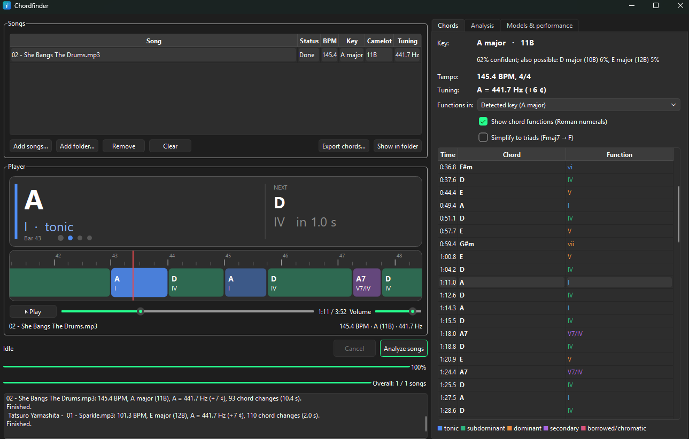

# Chordfinder

Offline desktop app that listens to your songs and tells you their **tempo (BPM)**, **key** (with its
**Camelot** code), **tuning** (A = 440 Hz or something else) and **chords**. Play a song in the built-in
player and its chords scroll by in real time, each with its function in the key, for example
**Fmaj7 (IVmaj7)** in C major. Everything runs on your own computer with small local models. After the
one-time model download (about 90 MB), no internet connection is needed.



| Task | Model | Notes |
|---|---|---|
| Chords | [BTC](https://github.com/jayg996/BTC-ISMIR19), a bi-directional Transformer for chord recognition (ISMIR 2019) | 170 chord types: maj, min, dim, aug, 6, m6, 7, maj7, m7, m(maj7), dim7, m7b5, sus2, sus4 on all 12 roots. A major/minor-only variant is included |
| Beats, bars, BPM | [Beat This!](https://github.com/CPJKU/beat_this) (ISMIR 2024) | state-of-the-art beat **and downbeat** tracker, so bar numbers and the meter are shown too |
| Key | [S-KEY](https://github.com/deezer/skey) from Deezer Research (ICASSP 2025) | 24 major and minor keys |
| Tuning | signal processing (librosa) | measures the reference pitch to a fraction of a cent; no model needed |
| GUI | PySide6 (Qt) | song queue, drag and drop, progress, cancel, player with live chord display |

Classic alternatives that need no download are built in too: a librosa beat tracker and a key finder
based on Krumhansl-Kessler key profiles applied to the song's chords and pitch content.

Audio is decoded with PyAV's bundled FFmpeg, so most audio and video formats work (`mp3`, `flac`, `wav`,
`m4a`, `ogg`, `opus`, `mp4`, `mkv`, …) without installing FFmpeg.

## Requirements

- Windows 10/11, Python 3.10–3.12
- An NVIDIA GPU is optional. The models are small, so the CPU is only a bit slower
  (a 4-minute song takes about 5–10 s on a GPU)
- Disk space: ~5 GB for the Python packages (mostly PyTorch), ~90 MB for the models

## Install and run

```bat
install.bat         :: one-time: creates .venv, installs PyTorch (CUDA) and the dependencies
Chordfinder.bat     :: starts the app (you can also drop songs onto it)
```

You can also run it manually with `.venv\Scripts\python -m chordfinder`.

## Usage

1. Add songs with **Add songs…**, **Add folder…** or by dragging them onto the window.
2. Click **Analyze songs**. The table fills in the BPM, key, Camelot code and tuning of each song.
3. Double-click a song (or select it and click **Play**, Ctrl+Space). While it plays:
   - the large display shows the **current chord** and its function, the **next chord** with a countdown,
     and the **bar and beat** you're on;
   - the **timeline** scrolls the chords past the red playhead. Click a chord to jump to it; scroll the
     mouse wheel to zoom;
   - the **Chords** tab lists every chord change and highlights the current one. Double-click a chord to
     play from there.
4. **Export chords…** saves the chords of the selected song as a readable chord chart (`.txt`), a MIREX
   `.lab` file (for other music software) or the complete analysis as `.json`.

Chord colours show the function family: **tonic** (I, iii, vi), **subdominant** (ii, IV), **dominant**
(V, vii°), **secondary dominants** (V/V, V7/vi, vii°7/V…) and **borrowed or chromatic** chords (bVII, bVI,
iv in a major key…).

Shortcuts: Ctrl+Space play/pause, Ctrl+Left / Ctrl+Right skip 5 s, Ctrl+O add songs, Ctrl+Q quit.

### What the results mean

| Result | Details |
|---|---|
| BPM | the main beat level. `128 BPM` for a steady tempo; `≈96 BPM (88–104)` when the tempo drifts (live recordings, rubato). Passages a tracker hears in double or half time are folded back onto the main beat |
| Meter | beats per bar from the downbeats, e.g. `4/4` or `3/4` (6/8 is shown as 3/4 or 6/4 depending on the felt beat) |
| Key | e.g. `Eb major · 5B`, with the model's confidence and the runner-up keys. Relative keys (C major / A minor) share a Camelot number |
| Tuning | `A = 440.0 Hz (standard)`, or e.g. `A = 432.0 Hz (−32 ¢)`. A recording tuned more than half a semitone away (such as a guitar tuned down to Eb) is indistinguishable from a song in another key at A = 440, so it shows up as that key |
| Function | Roman numerals relative to the **major scale of the tonic** in both modes, the usual convention in pop and jazz analysis: in A minor, F is **bVI** and G is **bVII**. Upper case = major, lower case = minor, ° diminished, ø half-diminished, + augmented |

### Chords tab options

| Option | Effect |
|---|---|
| Functions in | the key the Roman numerals refer to. Pick another key when a song modulates or when the detected key is the relative major/minor of the one you hear. The choice is remembered per song until you close the app, and is used by **Export chords…** |
| Show chord functions | hide or show the Roman numerals everywhere |
| Simplify to triads | shows Fmaj7, F6 and F7 as F, Am7 as Am, and so on |

### Analysis options

| Option | Effect |
|---|---|
| Align chord changes to the beat | moves each chord change onto the nearest beat when it's close to one. Gives a tidier chart; turn it off for rubato music |
| Shortest chord | chords shorter than this (default 0.4 s) are merged into a neighbour. Raise it for a simpler chart; 0 keeps every chord the model hears |
| Compensate for the song's tuning | analyses chords and key relative to the measured reference pitch instead of A = 440 Hz. Leave it on |
| Remember results | results are saved in `%LOCALAPPDATA%\Chordfinder\results`, so a song you add again appears instantly. **Forget saved results** clears them |
| Save a chord chart next to each song | writes `<song>.chords.txt` beside the audio file |

When every song is analysed, **Analyze songs** analyses the selected songs again with the current options.

## Managing models

Everything is under **Models & performance**:

- **Chord / Beat / Key model**: shows whether each model is downloaded, its size on disk and a short
  description. The first analysis downloads the selected models automatically.
- **Download selected models now**: downloads them ahead of time. Every file is checked against a
  pinned SHA-256 hash before it is used, and interrupted downloads resume where they stopped. After that,
  turn off **Allow model downloads** for strict offline operation.
- **Delete a model…**: frees its disk space.
- **Models folder**: models are stored in `%LOCALAPPDATA%\Chordfinder\models`, in one subfolder per task.
  **Move…** moves the downloaded models to another folder or drive and switches the app to the new
  folder. **Browse…** only points the app at a folder that already contains models; nothing is moved.
- **Device**: NVIDIA GPU (CUDA) or CPU.

| Model | Download | Notes |
|---|---|---|
| BTC, 170 chord types (default) | 12 MB | seventh, sixth, suspended and diminished chords |
| BTC, major and minor only | 12 MB | 24 triads; simpler, steadier charts |
| Beat This! (default) | 77 MB | beats and downbeats |
| Beat This! small | 8 MB | 10× smaller, slightly less accurate |
| Classic beat tracker | – | librosa; no downbeats, so no bar numbers or meter |
| S-KEY (default) | 0.8 MB | |
| Chord and chroma profiles | – | Krumhansl-Kessler profiles over the recognised chords and the audio |

## Command line

```bat
.venv\Scripts\python -m chordfinder.cli song.mp3
.venv\Scripts\python -m chordfinder.cli "D:\Music\Album" --no-chords      :: summary per song only
.venv\Scripts\python -m chordfinder.cli song.flac --lab > song.lab        :: MIREX chord labels
.venv\Scripts\python -m chordfinder.cli song.mp3 --chord-model btc-majmin --min-chord 1 --chart
```

Run `python -m chordfinder.cli --help` for all options (`--cpu`, `--offline`, `--no-cache`, …).

## Tests

```bat
.venv\Scripts\python -m pytest
```

The end-to-end tests synthesise songs with a known tempo, key, tuning and chord progression; they are
skipped until the default models are downloaded.

## Credits

The networks in `chordfinder/nets` are adapted from their authors' code, all under the MIT License:
BTC by Jonggwon Park ([paper](https://arxiv.org/abs/1907.02698)), S-KEY by Deezer Research
([paper](https://arxiv.org/abs/2501.12907)) with ConvNeXt blocks by Meta FAIR. Beat This! by the
Institute of Computational Perception, JKU Linz ([paper](https://arxiv.org/abs/2407.21658)) is used as a
library. The model weights are downloaded from the authors' own repositories.
